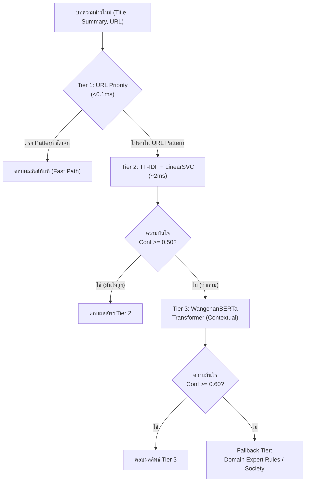
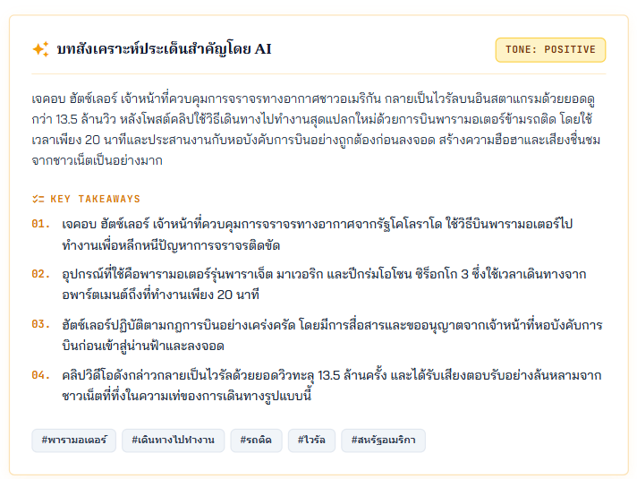

# 📰 NEWSROOM — Thai News Aggregator & Intelligent Summarizer

ระบบรวบรวมและวิเคราะห์ข่าวสารภาษาไทยอัตโนมัติแบบเรียลไทม์จาก 14 สำนักข่าวชั้นนำ พร้อมระบบจัดหมวดหมู่อัจฉริยะ 3 ระดับ (3-Tier Classification Engine), ระบบติดตามประเด็นข่าวมหากาพย์และจัดอันดับเทรนด์ (Two-Stage Story Identification & Deterministic Trending), ระบบสรุปใจความสำคัญด้วย AI (LLM Executive Briefing), สถาปัตยกรรมแยกส่วนอิสระ (Headless Decoupled Architecture), เว็บแอปพลิเคชันแบบก้าวหน้า (Progressive Web App - PWA) ที่ปลอดภัยต่อลิขสิทธิ์และเคารพความเป็นส่วนตัว พร้อมเล่มรายงานวิชาการฉบับสมบูรณ์ (LaTeX Template Project 2026 v2 & Example A)

---

## 🌟 จุดเด่นของระบบ (Key Highlights)

- 📡 **รวบรวมข่าวสารจาก 14 สำนักข่าวชั้นนำ:** ดึงข่าวต่อเนื่องทั้งผ่าน RSS Feed, HTTP Scraping และ Headless Browser (Playwright with CDP sessions)
- 🧠 **ระบบจำแนกหมวดหมู่อัจฉริยะ 3 ระดับ (3-Tier Classification Engine):**
  - **Tier 1 (Fast-Path URL Priority, <0.1ms):** สกัดหมวดหมู่จากโครงสร้าง URL path และ slug ภาษาไทย/อังกฤษ
  - **Tier 2 (Fast Machine Learning, ~2ms):** โมเดล Calibrated LinearSVC ร่วมกับ TF-IDF 20,000 มิติ ตัดคำภาษาไทยด้วย PyThaiNLP (`newmm`)
  - **Tier 3 (Deep Learning Transformer):** โมเดล **WangchanBERTa Sequence Classification** ตรวจจับบริบทเชิงลึกข้าม 9 หมวดหมู่สำหรับข่าวที่กำกวมสูง (F1-score 0.941)
  - **Fallback Tier:** ระบบสำรองคำสำคัญทางภาษาศาสตร์ (Keyword Cues) และค่าปริยายสังคม
- 🧭 **ติดตามมหากาพย์ประเด็นข่าว 2 ชั้น (Two-Stage Story & Macro-Event Identification):**
  - **Stage A (Sub-Events):** จัดกลุ่มข่าวเหตุการณ์ย่อยด้วย Dense Semantic Embeddings (WangchanBERTa 768-d), Cosine Similarity ($0.72$--$0.82$), การยืนยัน Named Entity (`thainer-v2`) และหน้าต่างสืบค้น 72 ชั่วโมงแบบไม่จำกัดอายุขัย พร้อม Centroid EMA ($\alpha=0.85$)
  - **Stage B (Macro Storyline):** เชื่อมโยงพัฒนาการมหากาพย์ข้ามช่วงเวลา พร้อมกลไกความปลอดภัยทางวิศวกรรม:
    - **Strict Province-Only Veto:** ยับยั้งการรวมกลุ่มข่าวที่ตรงกันเพียงชื่อจังหวัด ป้องกันการหลอมรวมข่าวอาชญากรรมหรืออุบัติเหตุต่างเรื่อง
    - **Episode-Scoped Anchors (45 วัน):** ควบคุมกรอบเวลาของมหากาพย์ ป้องกันการรวมข้ามฤดูกาล
    - **Thai Normalization & Location Hierarchy:** ระบบพจนานุกรมชื่อเฉพาะและลำดับชั้นสถานที่ 3 ระดับครอบคลุม 77 จังหวัด
    - **Inter-Process File Lock (`file_lock.py`):** ป้องกันการบันทึกข้อมูลชนกันข้ามโพรเซสด้วย Kernel-level Lock
- 🛡️ **เกตคัดกรองความเกี่ยวข้องและแบบจำลองหลักฐาน (Relevance Gate & Evidence Dossier):** คัดแยกข่าว 3 กลุ่ม (*Relevant Evidence*, *Context*, *Excluded*) ก่อนส่งให้ LLM สังเคราะห์ พร้อมระบบ Output Validator ตรวจสอบความถูกต้องและป้องกันข่าวบริบทแวดล้อมปนเปื้อนเข้าไทม์ไลน์หลัก
- 📊 **จัดอันดับเทรนด์ข่าวเชิงสถิติ (Deterministic Trending Engine):** คำนวณความร้อนแรงของประเด็นข่าวด้วย 6 มิติทางสถิติ (Volume 25%, Burst Velocity 30%, Outlet Diversity 25%, Recency Decay 10%, Novelty 5%, Telemetry 5%) ปราศจาก LLM ในขั้นตอนคำนวณคะแนน โปร่งใส ตรวจสอบได้ พร้อมระบบลดทอนคะแนนข่าวกิจวัตรประจำวัน ($0.25\times$)
- ⚡ **สรุปเนื้อหาข่าวสารด้วย AI (Executive Briefing):** สังเคราะห์สาระสำคัญ (Key Takeaways), วิเคราะห์โทนข่าว (Sentiment) และจัดทำไทม์ไลน์เหตุการณ์ด้วย Gemini LLM พร้อมระบบ Heuristic Fallback เมื่อ API ขัดข้อง
- 🏗️ **สถาปัตยกรรมแยกส่วนอิสระ (Headless Decoupled Architecture):** Backend รองรับโหมด Headless API (`HEADLESS=true`) พร้อม Dynamic CORS Matrix และ Socket.IO ซิงโครไนซ์สมบูรณ์แบบ สามารถแยกรัน Frontend อิสระบนพอร์ตหรือ CDN ใดก็ได้
- 🍱 **อินเทอร์เฟซผู้ใช้แบบ Bento Grid & Modular Clean Architecture:**
  - ดีไซน์ Bento Hub สวยงามทันสมัย แบ่งสัดส่วนข่าวเด่น เทรนด์มหากาพย์ และข่าวล่าสุด
  - แยกส่วนตรรกะ UI ออกเป็น 11 โมดูลเดี่ยวตามหลัก Single Responsibility (ทุกไฟล์ขนาดต่ำกว่า 800 บรรทัด)
  - ตัวกรองวันที่กำหนดเอง (Custom Date Filter) พร้อม Date Picker ภาษาไทย
  - สวิตช์สลับลำดับการแสดงผลไทม์ไลน์ (Latest / Oldest)
  - หน้าต่างอ่านบทความแบบ In-App Clean Markdown Reader
  - Workstation สำหรับนักข่าวและนักสืบสวน (Issue Explorer) และหน้าต่างตรวจสอบการทำงานระบบ (Ops Console)
- 🔒 **การคุ้มครองความเป็นส่วนตัวและ PDPA (Zero-PII Compliance):** จัดเก็บข้อมูล Telemetry และการตั้งค่าบนฝั่งไคลเอนต์ (LocalStorage) เท่านั้น ปราศจากการเก็บรวบรวมข้อมูลส่วนบุคคลที่ระบุตัวตนได้
- 📱 **สถาปัตยกรรม PWA ปลอดภัยลิขสิทธิ์ (Copyright-Safe PWA):** ติดตั้งเป็นแอปพลิเคชันบนมือถือและคอมพิวเตอร์ รองรับการอ่านออฟไลน์ และหลีกเลี่ยงการละเมิดลิขสิทธิ์รูปภาพด้วยภาพเวกเตอร์ Editorial Placeholder
- 📸 **ไปป์ไลน์บันทึกภาพหน้าจออัตโนมัติ (Playwright Visual Pipeline):** สคริปต์อัตโนมัติจับภาพหน้าจอระบบ 6 มุมมองหลักสำหรับประกอบเล่มรายงานวิชาการแบบ Zero-diff
- 🎓 **เอกสารรายงานวิชาการระดับมืออาชีพ (XeLaTeX Academic Report):** รายงานโครงงาน 5 บท + 3 ภาคผนวก ความยาว 99 หน้า จัดทำตาม Template Project 2026 v2 & Example A พร้อมแผนภาพเวกเตอร์ TikZ บริสุทธิ์ 6 รูปแบบ ตารางแคตตาล็อก 38 รายการ และคงคุณสมบัติห้ามใช้เครื่องหมายโคลอนในข้อความภาษาไทยอย่างเคร่งครัด

---

## 🗂️ โครงสร้างโปรเจกต์ (Project Structure)

```
backend/
├── main.py                          — FastAPI application factory, headless toggle & Socket.IO mounting
├── config.py                        — ศูนย์กลางตั้งค่าคอนฟิก (Settings singleton, Headless toggle & CORS Matrix)
├── capture_report_screenshots.py    — Playwright automated screenshot pipeline สำหรับเล่มรายงาน (M-01 to M-06)
├── .env / .env.example              — Environment variables (API keys, model checkpoints, parameters)
├── core/
│   ├── browser.py                   — Playwright browser automation (Service + Local Fallback)
│   ├── constants.py                 — ค่าคงที่ของระบบ และ HTTP Browser Headers
│   ├── fetcher_service.py           — HTML extraction & Markdown converter
│   ├── file_lock.py                 — Cross-platform Inter-Process Kernel File Lock (fcntl/msvcrt)
│   ├── thai_normalizer.py           — Thai NLP normalization, alias resolution & 77-province hierarchy
│   ├── url_utils.py                 — URL canonicalization & tracking parameter stripper
│   └── socket_manager.py            — Socket.IO singleton manager สำหรับสตรีมมิ่งข่าวและ Dynamic CORS
├── schemas/
│   ├── news_schema.py               — Pydantic models (ArticleRecord, NewsSummary, CollectRequest)
│   ├── story_schema.py              — Pydantic models (StoryRecord, TimelineEvent, StorySynthesis)
│   ├── trending_schema.py           — Pydantic models (TrendingStoryItem, TrendingScoreBreakdown)
│   ├── macro_event_schema.py        — Pydantic models (MacroEventRecord, TopicCluster)
│   └── event_evidence_schema.py      — Pydantic models สำหรับตรวจสอบความสัมพันธ์ของหลักฐานข่าว
├── repo/
│   ├── news_repo.py                 — ข้อมูลข่าวพื้นฐาน (FileNewsRepository / NewsRepositoryPort)
│   ├── story_repo.py                — ข้อมูลกลุ่มข่าวแบบต่อเนื่อง (FileStoryRepository / MongoDB)
│   ├── engagement_repo.py           — ข้อมูล Telemetry การมีส่วนร่วมของผู้ใช้ (คลิก, สรุป, บุ๊กมาร์ก)
│   ├── macro_event_repo.py          — การจัดเก็บกลุ่มเหตุการณ์ระดับมหภาค
│   └── sqlite_news_repo.py          — การจัดเก็บสำรองด้วย SQLite
├── routers/
│   ├── news_router.py               — API ข่าว: /api/news, /api/sources, /api/categories, /api/status
│   ├── story_router.py              — API ประเด็นข่าว: /api/stories, /api/stories/{id}, /api/storylines
│   ├── trending_router.py           — API เทรนด์: /api/trending/stories, /api/trending/score-breakdown
│   ├── collect_router.py            — API สรุปข่าว: /api/collect-md (LLM Summarization)
│   ├── monitoring_router.py         — API ตรวจสอบสถานะระบบ: /api/monitoring/health, /api/monitoring/metrics
│   └── macro_event_router.py        — API จัดการเหตุการณ์ระดับมหภาค
├── services/
│   ├── scraper_service.py           — Background loop ทำงานดึงข่าวรอบละ 15 นาที
│   ├── classifier_service.py        — เครื่องมือจัดหมวดหมู่อัจฉริยะ 3-Tier Multi-strategy Classifier
│   ├── story_service.py             — การจับคู่และรวมกลุ่มบทความข่าวแบบ Online Incremental
│   ├── trending_service.py          — การคำนวณคะแนนความร้อนแรงของประเด็นข่าวด้วย 6 มิติทางสถิติ
│   ├── story_presentation_service.py — สังเคราะห์หัวข้อข่าวและไทม์ไลน์ภาพรวมด้วย LLM
│   ├── summarizer_service.py        — บริการถอดใจความและสรุปบทความข่าวรายชิ้น
│   ├── entity_extractor.py          — สกัด Named Entities (PyThaiNLP thainer-v2)
│   └── browser_service.py           — จัดการ Playwright CDP sessions
├── scrapers/
│   ├── registry.py                  — Decorator @register_source และแคตตาล็อกสำนักข่าว
│   ├── helpers.py                   — HTML/RSS parser, ตัวดึงรูปภาพ และ Article Builder
│   └── sources.py                   — สคริปต์สแครปข่าวสำหรับ 14 สำนักข่าว
├── model/
│   ├── tfidf_vectorizer.pkl         — TF-IDF Vectorizer สำหรับข้อความภาษาไทย
│   ├── svm_classifier.pkl           — Support Vector Machine Classifier
│   └── wangchanberta_classifier     — Local Offline Embedding Checkpoint (WangchanBERTa)
└── tests/                           — ชุดทดสอบระบบครอบคลุมกว่า 420+ กรณีทดสอบ

frontend/
├── index.html                       — หน้าเว็บหลักแบบ Responsive Bento Grid Single Page Application (SPA)
├── manifest.webmanifest             — Progressive Web App Manifest
├── sw.js                            — Service Worker สำหรับแคชและประมวลผลออฟไลน์
└── static/
    ├── app.css                      — สไตล์ชีต Editorial Theme และ Tailwind Utilities
    ├── config.js                    — การตั้งค่าฝั่งผู้ใช้ (4-Tier API Resolution, หมวดหมู่, สีสำนักข่าว)
    ├── api.js                       — REST API Client อิสระ พร้อม Typed Errors และ Normalization
    ├── socket.js                    — Dedicated WebSocket Manager พร้อม Pub/Sub Event Bus
    ├── UI.js                        — Thin Barrel Facade re-exporting โมดูลคอมโพเนนต์ย่อย
    ├── utils/
    │   └── common.js                — ฟังก์ชันช่วยจัดรูปแบบ, XSS Escaping, วันที่ปฏิทินไทย
    ├── components/
    │   ├── status.js                — สถานะการเชื่อมต่อ WS, สถิติ Telemetry, Ticker บาร์
    │   ├── filters.js               — แถบเลือกหมวดหมู่, ตัวกรองสำนักข่าว, ตัวกรองช่วงวันที่, แถบค้นหา
    │   ├── cards.js                 — ข่าวการ์ดแบบ Responsive Grid, Pagination, Dateline
    │   ├── reader.js                — หน้าต่างอ่านบทความ In-App Clean Reader, Switch View
    │   ├── hero.js                  — Hero Carousel ข่าวเด่น พร้อม Autoplay Lifecycle
    │   ├── sports-intelligence.js   — ตัวจำแนกประเภทกีฬา 10 สาขา และการตรวจจับคลัสเตอร์
    │   ├── sports.js                — Sports Hub View, Bento Grid กีฬา, AI Digest
    │   ├── storyline.js             — Macro Storyline View, ลำดับเหตุการณ์มหากาพย์, ตัวกรอง/เรียงลำดับ
    │   ├── digest.js                — AI Synthesis Dossier Modal, การตรวจสอบหลักฐาน
    │   └── evaluation.js            — หน้าประเมินโครงงานและการตอบแบบสอบถาม
    └── main.js                      — State Manager, Dynamic View Loader, Hash Routing (`#/`, `#/storyline/`, `#/evaluation`, `#/issues`, `#/ops`)

docs/                                — เอกสารและรายงานวิชาการ
└── report/
    ├── main.tex                     — ไฟล์คอมไพล์หลัก XeLaTeX + Biber
    ├── cskkuproject.cls             — LaTeX Document Class มาตรฐานวิทยาลัยการคอมพิวเตอร์ มข. (Template v2)
    ├── references.bib               — รายการบรรณานุกรมงานวิจัยและมาตรฐานวิศวกรรม
    ├── frontmatter/                 — ปกหน้า, บทคัดย่อภาษาไทย/อังกฤษ, กิตติกรรมประกาศ
    ├── chapters/                    — เนื้อหาโครงงาน 5 บท (สอดคล้องตามเกณฑ์ Example A)
    ├── backmatter/                  — ภาคผนวก ก (คู่มือและการทดสอบ M-01 to M-06), ภาคผนวก ข, ภาคผนวก ค, ประวัติผู้เขียน
    └── images/                      — ภาพประกอบระบบและภาพสกรีนช็อตอัตโนมัติจาก Playwright
```

---

## 🏛️ สถาปัตยกรรมแยกส่วน (Decoupled Headless Architecture)

ระบบได้รับการออกแบบเพื่อรองรับการแยกส่วนอย่างสมบูรณ์ระหว่าง Backend API Microservice และ Detached Client:

```
┌────────────────────────────────┐         ┌────────────────────────────────┐
│   Detached Frontend Client     │         │    Headless Backend API        │
│   (Vite / CDN / Any Port)      │         │    (FastAPI + Socket.IO :5000) │
│                                │  REST   │                                │
│   • api.js (HTTP Client)       ├────────►│  • /api/news, /api/stories     │
│   • socket.js (Pub/Sub)        │◄────────┤  • /api/status, /api/collect   │
│   • 4-Tier Endpoint Resolver   │  WS/IO  │  • Dynamic CORS Matrix         │
│   • Modular ES Components      │         │  • Root Catalog (GET /)        │
└────────────────────────────────┘         └────────────────────────────────┘
```

1. **Headless API Mode (`HEADLESS=true`):** ปิดการ Mount Static Files อัตโนมัติ โดยที่ Root Endpoint (`GET /`) จะส่งกลับ Service Catalog ในรูปแบบ JSON แสดงรายการ Service Health, Version และ API Endpoints ทั้งหมด
2. **Dynamic CORS Matrix:** รองรับการเชื่อมต่อข้าม Origin อย่างยืดหยุ่น ทั้ง Localhost หลากพอร์ต, Private Network IPs, Production Domains และ Regex Matching พร้อมการรองรับ Credentials สมบูรณ์แบบ
3. **Socket.IO Origin Synchronization:** ตัวจัดการ Socket.IO เชื่อมโยงและใช้กฎ CORS เดียวกันกับ FastAPI ทำให้การ Handshake แบบ Real-time ข้ามโดเมนทำงานได้อย่างราบรื่น
4. **4-Tier Client Runtime Resolution:** ใน `config.js` ไคลเอนต์จะค้นหา API Base URL และ WebSocket URL ตามลำดับความสำคัญ:
   - `window.__API_BASE__` / `window.__SOCKET_URL__` (Injected Config)
   - Meta Tags (`<meta name="api-base">`)
   - Query Parameters (`?api_base=...`)
   - Origin Fallback (Same-origin หรือ default `http://localhost:5000`)

---

## 🍱 สถาปัตยกรรมอินเทอร์เฟซผู้ใช้แบบโมดูลาร์ (Modular UI Architecture)

ไฟล์ `UI.js` เดิมได้รับการจัดโครงสร้างใหม่เป็น 11 โมดูลเดี่ยวตามหลัก **Clean Code & Single Responsibility**:

| โมดูล | ขอบเขตความรับผิดชอบ | ขนาด (LOC) |
|---|---|---|
| [utils/common.js](file:///frontend/static/utils/common.js) | XSS Sanitization (`esc`), ปฏิทินพุทธศักราช, Format เวลาไทย | ~300 |
| [components/status.js](file:///frontend/static/components/status.js) | WebSocket Badge, Scraper Telemetry, Ticker Marquee | ~160 |
| [components/filters.js](file:///frontend/static/components/filters.js) | Category Navigation, Search Input, Source Chips, Custom Date Picker | ~250 |
| [components/cards.js](file:///frontend/static/components/cards.js) | News Grid Rendering, Responsive Dateline, Pagination | ~235 |
| [components/reader.js](file:///frontend/static/components/reader.js) | View Switching (`switchView`), In-App Clean Reader, Modal Helpers | ~500 |
| [components/hero.js](file:///frontend/static/components/hero.js) | Hero Trending Carousel, Touch Swipe, Autoplay Lifecycle | ~710 |
| [components/sports-intelligence.js](file:///frontend/static/components/sports-intelligence.js) | จำแนกกีฬา 10 ประเภท (ฟุตบอลไทย/ยุโรป, แบดมินตัน, วอลเลย์บอล ฯลฯ) | ~215 |
| [components/sports.js](file:///frontend/static/components/sports.js) | Sports Hub View, Discipline Tabs, AI Digest Cards | ~740 |
| [components/storyline.js](file:///frontend/static/components/storyline.js) | Multi-source Storyline View, Perspective Breakdown, Latest/Oldest Sort | ~780 |
| [components/digest.js](file:///frontend/static/components/digest.js) | Event Progression Synthesis, Cross-Outlet Citations, Quality Audit | ~340 |
| [components/evaluation.js](file:///frontend/static/components/evaluation.js) | Research Project Evaluation View, Scoring Form | ~160 |
| [UI.js](file:///frontend/static/UI.js) | Thin Backward-Compatible Barrel Facade (Re-exporting All) | ~33 |

- **ทุกไฟล์มีขนาดไม่เกิน 800 บรรทัด** อย่างเคร่งครัด
- **ลด DOM Thrashing & Memory Leaks:** ปิดการทำงานของ Autoplay Timer ชั่วคราวเมื่อผู้ใช้สลับหน้าจอ (เช่น เข้าโหมดอ่านบทความเจาะลึก) หรือพับแท็บเบราว์เซอร์ (`visibilitychange`)
- **Outside-Click / Backdrop Dismiss:** แตะหรือคลิกบริเวณพื้นที่ว่างด้านนอกการ์ด หรือกดปุ่ม `Escape` เพื่อปิด Modal ทุกตัวได้อย่างสะดวกรวดเร็ว
- **Responsive Bento Layout:** จัดวางองค์ประกอบอย่างลงตัวทั้งบนสมาร์ตโฟน แท็บเล็ต และคอมพิวเตอร์เดสก์ท็อป

---

## 🧠 ระบบจำแนกหมวดหมู่ข่าว (3-Tier Classification Engine)



1. **Tier 1: Fast-Path URL Priority (< 0.1ms)**
   - สกัดหมวดหมู่จาก URL path หรือ slug อัตโนมัติ (เช่น `/politics`, `/business`, `/sport`, `/tech`, `/foreign`, `/local` รวมถึง URL ภาษาไทยแบบ Percent-encoded)
   - หากเงื่อนไขตรงกับพจนานุกรมความมั่นใจสูง จะจัดหมวดหมู่ทันทีโดยไม่ต้องผ่าน NLP หรือ Machine Learning ประหยัดพลังงานประมวลผลสูงสุด
2. **Tier 2: Fast Machine Learning (Calibrated LinearSVC + TF-IDF, ~2ms)**
   - ตัดคำภาษาไทยด้วย PyThaiNLP (`newmm`) และแปลงเวกเตอร์ด้วย `TfidfVectorizer` (20,000 features) พร้อมโมเดล LinearSVC ที่ผ่านการปรับแต่งความน่าจะเป็นด้วย `CalibratedClassifierCV`
   - หากความมั่นใจ $\text{conf} \ge 0.50$ จะตอบผลลัพธ์ทันทีด้วยความเร็วสูง
3. **Tier 3: Deep Learning Escalation (Fine-tuned WangchanBERTa Transformer)**
   - กรณีที่โมเดล Tier 2 มีความมั่นใจต่ำกว่าเกณฑ์ ($\text{conf} < 0.50$) หรือเนื้อหาข่าวมีความกำกวมสูง ระบบจะส่งต่อให้โมเดล **WangchanBERTa Sequence Classification** เข้ามาอ่านบริบทเชิงลึกทั้งบทความเพื่อจำแนก 9 หมวดหมู่อย่างแม่นยำสูงสุด (F1-score 0.941)
4. **Fallback Tier: Domain Expert Rules & Society Default**
   - ในกรณีฉุกเฉินที่โมเดลไม่มั่นใจหรือขัดข้อง จะมีระบบสำรองด้วยกฎคำสำคัญทางภาษาศาสตร์ (Keyword Cues) และกำหนดค่าปริยายเป็น `society`

---

## 🧭 ระบบติดตามเรื่องราวและจัดอันดับเทรนด์ (Two-Stage Architecture)

### Stage A: Persistent Online Story Identification
- **Online Incremental Clustering:** ข่าวแต่ละบทความที่ดึงเข้ามาใหม่จะถูกนำมาประเมินทันที (`StoryService.assign_article`) โดยไม่จำเป็นต้อง re-cluster ข่าวทั้งหมดใหม่
- **Semantic Vector Similarity:** สกัดเวกเตอร์ขนาด 768 มิติด้วย WangchanBERTa ทำ Cosine Similarity เทียบกับ Centroid ของประเด็นข่าว (Threshold $0.72$--$0.82$)
- **Secondary Entity Confirmation Gate:** สกัด Named Entities (บุคคล, องค์กร, สถานที่) ด้วย PyThaiNLP `thainer-v2` เพื่อยืนยันความถูกต้องในกรณีค่าความคล้ายคลึงก้ำกึ่ง ($0.74 \le \text{sim} < 0.85$)
- **Non-Capping 72-Hour Candidate Window:** ค้นหาประเด็นข่าวที่มีความเคลื่อนไหวภายใน 72 ชั่วโมง ทำให้ประเด็นข่าวที่เกิดขึ้นต่อเนื่องเป็นสัปดาห์ (เช่น อุทกภัย, คดีความ) ถูกร้อยเรียงอยู่ภายใต้ `story_id` เดียวกันได้อย่างแม่นยำ
- **Centroid Exponential Moving Average (EMA, $\alpha=0.85$):** ปรับค่าเวกเตอร์แกนกลางของประเด็นข่าวอย่างราบรื่นตามความคืบหน้าของสถานการณ์

### Stage B: Deterministic Trending Engine
จัดอันดับความร้อนแรงของประเด็นข่าวด้วย 6 มิติทางสถิติที่โปร่งใส ตรวจสอบได้ และปราศจาก LLM ในการคำนวณคะแนน:
- **Volume Score (25%):** จำนวนบทความข่าวที่รายงานในรอบ 24 ชั่วโมง ($\ln(1 + N_{\text{recent}})$)
- **Burst Velocity Score (30%):** อัตราการเพิ่มขึ้นอย่างรวดเร็วของข่าวเปรียบเทียบกับช่วงก่อนหน้า
- **Diversity Score (25%):** ความหลากหลายของสำนักข่าวที่รายงาน ($\sqrt{N_{\text{outlets}}}$) พร้อมระบบลดทอนคะแนนสำหรับข่าวคัดลอก (Syndication Discount)
- **Recency Decay (10%):** ลดทอนคะแนนตามกาลเวลาด้วย Exponential Half-Life Decay ($\tau = 12$ ชั่วโมง)
- **Novelty Score (5%):** ความแปลกใหม่ของประเด็นเมื่อเทียบกับประเด็นข่าวอื่น
- **Engagement Telemetry (5%):** สถิติการมีส่วนร่วมของผู้อ่านแบบไม่ระบุตัวตน (คลิก, สรุปเนื้อหา, บุ๊กมาร์ก)
- **Routine News Penalty ($0.25\times$):** ลดทอนคะแนนข่าวที่เป็นกิจวัตรประจำวัน (ผลสลากกินแบ่ง, รายงานสภาพอากาศ, ราคาน้ำมัน/ทองคำประจำวัน) ไม่ให้แย่งพื้นที่เทรนด์ข่าวสำคัญ

---

## ⚡ ระบบสรุปเนื้อหาข่าวสารด้วย AI (Executive Briefing & LLM Summarization)

ระบบใช้ประโยชน์จาก Large Language Model (Gemini ผ่าน KKU Gen.AI API) ในการวิเคราะห์และถอดรหัสเนื้อหาข่าวสารแบบอัตโนมัติ โดยส่งคืนโครงสร้างข้อมูล JSON ที่ประกอบด้วย:
1. **Executive Briefing:** สรุปย่อสาระสำคัญของข่าว 2–3 ประโยค
2. **Key Takeaways:** ประเด็นสำคัญเชิงลึกแบบจำแนกข้อ (Bullet Points) พร้อมจัดลำดับความสำคัญ
3. **Sentiment Analysis:** วิเคราะห์โทนอารมณ์ของเนื้อหาข่าว (POSITIVE / NEUTRAL / NEGATIVE)
4. **Hashtags Extraction:** สกัดคีย์เวิร์ดและแฮชแท็กที่เกี่ยวข้องสำหรับจัดหมวดหมู่และเชื่อมโยงหัวข้อข่าว

<p align="center">
  
</p>

---

## 📡 สำนักข่าวที่รองรับ (14 สำนักข่าว)

| สำนักข่าว | Base URL | รูปแบบการดึงข้อมูล | หมวดหมู่หลักผ่าน URL Priority |
| :--- | :--- | :--- | :--- |
| **ไทยรัฐ (Thairath)** | `https://www.thairath.co.th` | RSS Feed | การเมือง, เศรษฐกิจ, ต่างประเทศ, ท้องถิ่น |
| **ไทยโพสต์ (Thai Post)** | `https://www.thaipost.net` | RSS Feed | การเมือง, เศรษฐกิจ, ทั่วไป |
| **มติชน (Matichon)** | `https://www.matichon.co.th` | RSS Feed | การเมือง, เศรษฐกิจ, บันเทิง, กีฬา, ต่างประเทศ |
| **เดลินิวส์ (Daily News)** | `https://www.dailynews.co.th` | HTTP Scraping | ทั่วไป, อาชญากรรม, การเมือง, กีฬา |
| **ข่าวสด (Khaosod)** | `https://www.khaosod.co.th` | RSS Feed (กรอง EN ออก) | การเมือง, กีฬา, บันเทิง, รอบโลก |
| **The Standard** | `https://thestandard.co` | RSS Feed | การเมือง, ธุรกิจ, เทคโนโลยี, สิ่งแวดล้อม |
| **101 World (The 101 World)** | `https://www.the101.world` | RSS + Playwright Fallback | สังคม, การเมือง, ความคิดเห็น |
| **ThaiPBS** | `https://www.thaipbs.or.th` | HTTP Scraping | การเมือง, เศรษฐกิจ, กีฬา, วิทยาศาสตร์ |
| **Bangkok Post** | `https://www.bangkokpost.com` | HTTP Scraping | Politics, Business, Sports, Tech, World |
| **คมชัดลึก (Komchadluek)** | `https://www.komchadluek.net` | Playwright Browser Fetch | กีฬา, บันเทิง, การเมือง, อาชญากรรม |
| **เนชั่นออนไลน์ (Nation Online)** | `https://www.nationtv.tv` | HTTP Scraping | สังคม, กีฬา, การเมือง |
| **กรุงเทพธุรกิจ (Bangkokbiznews)** | `https://www.bangkokbiznews.com` | HTTP Scraping | ธุรกิจ, การเงิน, เทคโนโลยี, ตลาดหุ้น |
| **PPTV HD 36** | `https://www.pptvhd36.com` | HTTP Scraping | ทั่วไป, ต่างประเทศ, กีฬา |
| **Techhub** | `https://www.techhub.in.th` | HTTP Scraping | เทคโนโลยี, ไอที, คอมพิวเตอร์ |

---

## 🏷️ หมวดหมู่ข่าว (Categories)

- 🏛️ **politics** (การเมือง)
- 📈 **economy** (เศรษฐกิจ / ธุรกิจ / การเงิน)
- 💻 **technology** (เทคโนโลยี / ไอที / AI)
- 💊 **health** (สุขภาพ / สาธารณสุข)
- 🌿 **environment** (สิ่งแวดล้อม / สภาพภูมิอากาศ)
- 👥 **society** (สังคม / คุณภาพชีวิต / การศึกษา)
- ⚽ **sports** (กีฬา — แยกย่อย 10 สาขา: บอลไทย, บอลยุโรป, แบดมินตัน, มวย, วอลเลย์บอล, เทนนิส, กอล์ฟ, มอเตอร์สปอร์ต, พาราเกมส์, กีฬาอื่นๆ)
- 🎬 **entertainment** (บันเทิง / ดารา / ภาพยนตร์)
- 🌍 **world** (ต่างประเทศ / รอบโลก)

---

## ✅ ความต้องการของระบบ (Prerequisites)

- **Python**: 3.10 ขึ้นไป
- **Node.js**: 18+ (สำหรับคอมไพล์ Tailwind CSS และรัน Frontend Test Suites)
- **Package Manager**: [uv](https://docs.astral.sh/uv/) (แนะนำเป็นอย่างยิ่ง)
- **Browser Automation**: Chromium (ติดตั้งผ่าน Playwright)
- **LaTeX Engine (สำหรับคอมไพล์เล่มรายงาน)**: XeLaTeX + Biber (`texlive-xetex`, `latexmk`) พร้อมฟอนต์ TH Sarabun New

---

## 📦 การติดตั้ง (Installation)

```bash
# 1. โคลนคลังโค้ด
git clone https://github.com/wittgenstein-byte/End-to-End_News_Collector-Summarizer.git
cd End-to-End_News_Collector-Summarizer

# 2. ติดตั้ง Python dependencies ทั้งหมดผ่าน uv
uv sync

# 3. ติดตั้ง Chromium สำหรับระบบสแครปข่าวและไปป์ไลน์จับภาพหน้าจอ
uv run playwright install chromium

# 4. ติดตั้ง Node dependencies สำหรับ Tailwind CSS
cd frontend && npm install && cd ..
```

---

## ⚙️ การตั้งค่าสภาพแวดล้อม (Environment Setup)

คัดลอกไฟล์ `backend/.env.example` เป็น `backend/.env` แล้วกำหนดค่าตามต้องการ:

```env
# LLM API (สำหรับสรุปใจความสำคัญและประมวลผลไทม์ไลน์)
LLM_API=your_api_key_here
LLM_BASE_URL=https://gen.ai.kku.ac.th/api/v1
LLM_MODEL=gemini-3.1-flash-lite-preview
LLM_TEMPERATURE=0.3

# Headless & Decoupling Settings
HEADLESS=false
CORS_ORIGINS=["http://localhost:5000","http://localhost:3000","http://127.0.0.1:5000"]

# Scraper Settings
INTERVAL_MINUTES=15
MAX_ARTICLES_PER_SOURCE=10
SUMMARY_SENTENCES=3
PAGE_SIZE=20

# Server
HOST=0.0.0.0
PORT=5000
```

---

## 🚀 วิธีรันระบบ (Run Server)

```bash
# คอมไพล์ CSS ด้วย Tailwind
npm --prefix frontend run build:css

# รันเซิร์ฟเวอร์หลักแบบ Full-Stack
uv run python backend/main.py

# หรือ รันในโหมด Headless API บริสุทธิ์ (แยก Frontend อิสระ)
HEADLESS=true uv run python backend/main.py
```

เปิดเว็บเบราว์เซอร์ที่: **`http://localhost:5000`**

---

## 🧪 การทดสอบระบบ (Testing & Verification)

```bash
# 1. รันชุดทดสอบ Backend ทั้งหมด (Pytest 420+ กรณีทดสอบ ผ่าน 100%)
uv run pytest -v

# 2. ทดสอบคุณสมบัติคงที่ระดับมหากาพย์ P0-P2 (Stage B Macro Invariants & Province Veto)
uv run pytest backend/tests/test_macro_p0_p2_invariants.py -v

# 3. ทดสอบระบบความสอดคล้องของหลักฐานและการคัดกรองความเกี่ยวข้อง (Relevance Gate)
uv run pytest backend/tests/test_relevance_enforcement.py -v

# 4. ทดสอบระบบ Decoupling, CORS Matrix และ Headless API
uv run pytest backend/tests/test_decoupling.py backend/tests/test_adversarial_cors_socketio.py -v

# 5. ทดสอบการสื่อสาร Client (Socket Pub/Sub & REST API Client)
node backend/tests/test_client_communication.mjs
node backend/tests/test_adversarial_api_m2.mjs

# 6. ทดสอบความถูกต้องของคอมโพเนนต์ย่อย (UI Component Decomposition)
node backend/tests/test_ui_decomposition.mjs

# 7. ทดสอบ Boundary Cases และ Cross-Module Lifecycle
node backend/tests/test_adversarial_m3_boundaries.mjs
node backend/tests/test_cross_module_lifecycle_m3.mjs
node backend/tests/test_modal_backdrop.mjs

# 8. รัน Benchmark วัดความแม่นยำ Pairwise & B-cubed F1 ของ Story Identification
uv run python scripts/evaluate_stories.py

# 9. รันรายงานตรวจสอบคุณภาพเทรนด์ข่าว (Trending Sanity Report)
uv run python scripts/trending_sanity_report.py
```

---

## 📸 ไปป์ไลน์จับภาพหน้าจอและคอมไพล์เล่มรายงาน (Report Generation)

### 1. จับภาพหน้าจอระบบอัตโนมัติด้วย Playwright
ระบบมีสคริปต์อัตโนมัติสำหรับดึงและจับภาพหน้าจอของอินเทอร์เฟซผู้ใช้ทั้ง 6 มุมมองหลัก เพื่อใช้ประกอบในภาคผนวก ก ของเล่มรายงาน:

```bash
# สั่งจับภาพหน้าจออัตโนมัติ (M-01 ถึง M-06) ไปยัง docs/report/images/
uv run python backend/capture_report_screenshots.py
```

| รหัสภาพ | รายละเอียดหน้าต่างระบบ | ปลายทางไฟล์ภาพ |
|---|---|---|
| **M-01** | หน้าหลัก Bento Hub SPA (Hero Carousel, Trending, Filter) | `docs/report/images/screenshot_m01_bento_hub.png` |
| **M-02** | หน้าต่างอ่านบทความ In-App Cleaned Reader | `docs/report/images/screenshot_m02_in_app_reader.png` |
| **M-03** | หน้าต่างสังเคราะห์มหากาพย์ข่าวและไทม์ไลน์ (Macro Dossier) | `docs/report/images/screenshot_m03_macro_dossier.png` |
| **M-04** | โต๊ะทำงานสืบสวนประเด็นข่าวเชิงลึก (Issue Explorer) | `docs/report/images/screenshot_m04_issue_explorer.png` |
| **M-05** | แผงควบคุมและตรวจสอบสถานะการทำงานระบบ (Ops Console) | `docs/report/images/screenshot_m05_ops_console.png` |
| **M-06** | หน้าต่างตั้งค่าความเป็นส่วนตัวและความยินยอม (Privacy Modal) | `docs/report/images/screenshot_m06_privacy_modal.png` |

### 2. คอมไพล์เล่มรายงานวิชาการ LaTeX (Template v2 & Example A)
เล่มรายงานวิชาการได้รับการพัฒนาด้วยภาษา LaTeX โดยใช้เอกสารคลาส `cskkuproject.cls` (ความยาว 99 หน้า พร้อม 6 แผนภาพ TikZ เวกเตอร์แท้):

```bash
# ไปยังไดเรกทอรีเล่มรายงาน
cd docs/report

# คอมไพล์ด้วย latexmk (XeLaTeX + Biber)
latexmk -xelatex -interaction=nonstopmode main.tex
```

ผลลัพธ์ไฟล์ PDF ฉบับสมบูรณ์จะอยู่ที่ `docs/report/main.pdf`

---

## 🔍 ตรวจสอบ Code Style & Type Safety

```bash
# ตรวจสอบ Code Style ด้วย Ruff
uv run ruff check backend/

# ตรวจสอบ Type Safety ด้วย MyPy
uv run mypy backend/ --ignore-missing-imports --explicit-package-bases
```

---

## 📄 ใบอนุญาตและการอ้างอิง

โปรเจกต์นี้พัฒนาขึ้นเพื่อการวิจัยและศึกษาทางวิชาการ (Educational & Academic Research) สาขาวิชาวิทยาการคอมพิวเตอร์ วิทยาลัยการคอมพิวเตอร์ มหาวิทยาลัยขอนแก่น รวบรวมข่าวสารจากสำนักข่าวเพื่อการวิเคราะห์และสรุปผลเชิงสังเคราะห์ ไม่มีการละเมิดหรือทำซ้ำภาพถ่ายที่มีลิขสิทธิ์ และเคารพมาตรฐานการคุ้มครองข้อมูลส่วนบุคคล (PDPA)
