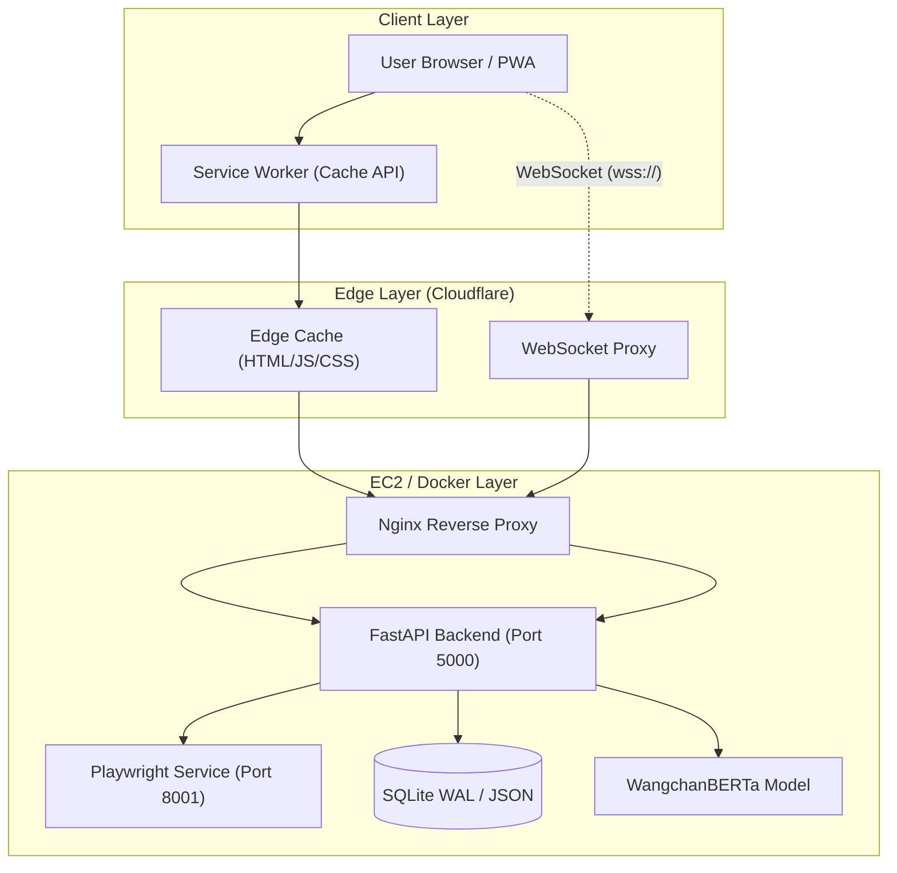
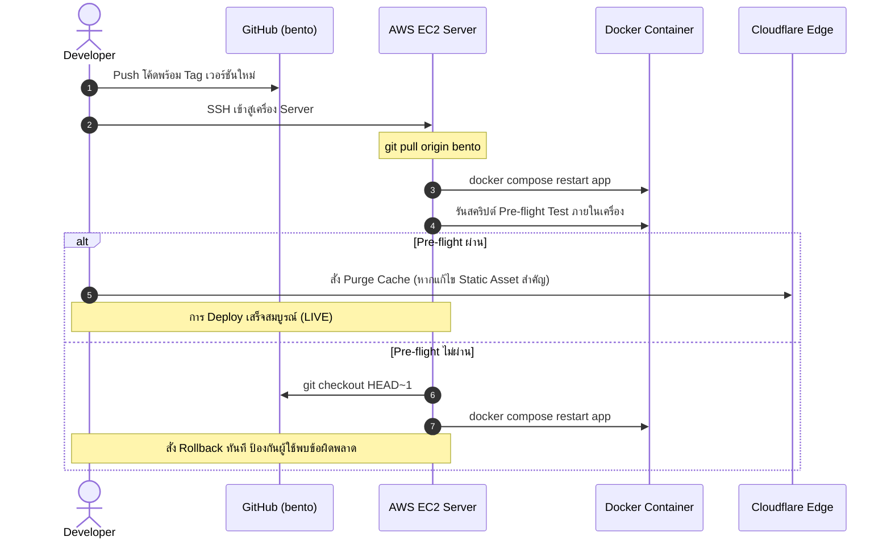

# แผนการพัฒนาและข้อกำหนดการทดสอบสำหรับ Production
**NEWSROOM — Editorial Intelligence Platform**
*เอกสารมาตรฐานวิศวกรรมซอฟต์แวร์: แผนการทดสอบ, มาตรการป้องกันข้อผิดพลาด และแนวทางการ Deploy สู่ Production*

---

## 1. บทนำและบทเรียนจากเหตุการณ์ที่ผ่านมา (Post-Mortem & Objectives)

จากการดำเนินงานและ Deploy ขึ้นสู่ Production บนสภาพแวดล้อม AWS EC2 + Nginx + Cloudflare ได้พบจุดเปราะบาง (Vulnerabilities) สำคัญ 4 ประการที่ทำให้ระบบหยุดชะงัก:

1. **Edge & Client Cache Inconsistency (Cloudflare & Service Worker)**:
   - การแก้ไขโค้ด JavaScript ฝั่ง Client แบบแยกไฟล์ (ES Modules) แต่ไม่ได้ทำ Cache Busting ที่ Sub-imports ทำให้ Edge Node ส่งไฟล์เก่าปะปนกับไฟล์ใหม่ เกิด `SyntaxError` / `TypeError` ทำให้แอปฯ หยุดทำงานทั้งหมด
2. **Environment & Native Dependency Discrepancy (Dev Windows vs Prod Linux Docker)**:
   - ไลบรารี Transformers / Tokenizer ทำงานต่างกันระหว่าง OS (เช่น `use_fast=False` คืนค่า boolean บน Linux เมื่อขาดไฟล์โมเดลเฉพาะทาง)
3. **Hyperparameter Mismatch on Real-World Data**:
   - ค่า Threshold ของ AI (Cosine Similarity 0.92) ถูกตั้งไว้เข้มงวดเกินไปสำหรับข่าวภาษาไทยจริง ทำให้ไม่มีการรวมกลุ่มข่าว (Zero Clustering)
4. **Silent WebSocket / Network Failures**:
   - การเชื่อมต่อ Socket.IO ขาด Telemetry/Error Handling ทำให้หน้าบ้านค้างที่สถานะ "ออฟไลน์" โดยไม่มี Log ระบุสาเหตุที่ชัดเจน

> [!IMPORTANT]
> **เป้าหมายหลัก**: สร้างกระบวนการพัฒนา (Development Workflow) และข้อกำหนดการทดสอบ (Testing Requirements) ที่เป็นระบบ เพื่อให้การ Deploy ทุกครั้ง **ปราศจาก Downtime**, **ไม่เกิด Stale Cache ค้าง**, และ **ตรวจพบข้อผิดพลาดล่วงหน้า 100% ก่อนถึงผู้ใช้งาน**

---

## 2. จุดเสี่ยงของระบบและมาตรการป้องกัน (System Fragility Points & Guardrails)



| จุดเสี่ยง (Risk Area) | สาเหตุที่อาจทำให้พัง | มาตรการป้องกันเชิงรุก (Guardrail) |
|---|---|---|
| **ES Module Sub-imports** | Cloudflare แคชไฟล์ `config.js` แต่ `main.js` เป็นเวอร์ชันใหม่ ทำให้เกิด Export Mismatch | 1. ใส่ `?v={VERSION}` ใน Sub-imports ทุกไฟล์<br>2. ตั้งค่า Header `Cache-Control: no-cache, must-revalidate` ที่ Backend สำหรับ Static Files |
| **Service Worker Cache** | Browser เก็บไฟล์แคชเก่าไว้ใน Cache Storage แม้ปิดเบราว์เซอร์แล้ว | 1. Bump `CACHE_NAME` ทุกครั้งที่มีการ Deploy<br>2. มี Script Clear Stale Cache ใน Event `activate` อัตโนมัติ |
| **AI / Tokenizer Loading** | โมเดลโหลดบน Docker ไม่สมบูรณ์ หรือขาดไฟล์น้ำหนัก | 1. เพิ่ม Pre-flight Model Smoke Test ใน Docker Build/Healthcheck<br>2. บังคับโหลดผ่าน `PreTrainedTokenizerFast(tokenizer_file=...)` |
| **Cosine Threshold Drift** | ข่าวจริงมีความหลากหลายทางภาษามากกว่าข้อมูลสังเคราะห์ | 1. เพิ่มชุด Integration Test ตรวจสอบ Similarity Benchmark บนข่าวจริง<br>2. ตั้ง Threshold อยู่ในช่วง $0.75 - 0.78$ |
| **Socket Connection Timeout** | Nginx ขาด Header Upgrade หรือ Cloudflare ปิด WebSocket | 1. รองรับ Dual-transport (`websocket` + `polling` fallback)<br>2. มี `connect_error` logging แสดงสาเหตุบนคอนโซล |

---

## 3. แผนการพัฒนาและปรับปรุงระบบ (Development Roadmap)

### ระยะที่ 1: การวางรากฐานและระบบควบคุมเวอร์ชัน (Immediate - สัปดาห์ที่ 1)
- [x] แก้ไข Bug การโหลด Tokenizer ด้วย `PreTrainedTokenizerFast`
- [x] Calibrate Cosine Threshold ให้เหมาะกับข่าวไทย ($0.76$)
- [x] เพิ่ม `NoCacheStaticFiles` ให้ Backend ส่ง Header ห้ามแคชไฟล์ JS/CSS ไปยัง Cloudflare
- [x] เพิ่ม Version Tagging (`?v=3.3.3`) ใน Sub-module imports
- [ ] **สร้าง Script สั่ง Build & Release แบบรวมศูนย์ (One-Click Release Tool)** เพื่อเปลี่ยนเลข Version อัตโนมัติในทุกจุด (`index.html`, `sw.js`, `main.js`, `UI.js`, `api.js`)

### ระยะที่ 2: ระบบ Automated Testing & Pre-deploy CI (สัปดาห์ที่ 2)
- [ ] ติดตั้งชุดทดสอบอัตโนมัติ (Automated Test Suite) ด้วย `pytest` และ `pytest-asyncio`
- [ ] เพิ่ม **Playwright Headless E2E Smoke Test** รันก่อนขึ้น Production:
  - ตรวจจับ Console Error ทุกชนิด
  - ตรวจสอบว่า Badge เปลี่ยนจาก "ออฟไลน์" เป็น "LIVE"
  - ตรวจสอบว่าข่าวและหัวข้อ Trending แสดงผลอย่างน้อย 1 การ์ด
- [ ] ทำ Pre-push Git Hook ป้องกันการ Push โค้ดที่มี Syntax Error

### ระยะที่ 3: ระบบเฝ้าระวังและการ Deploy แบบไร้รอยต่อ (สัปดาห์ที่ 3-4)
- [ ] ตั้งค่า Health Check Endpoint (`/readyz`) ที่ตรวจสอบทั้ง Storage, Model และ Playwright
- [ ] สร้าง Rollback Script ภายใน 1 คำสั่งกรณีเกิดข้อผิดพลาด
- [ ] เชื่อมต่อ Error Logging (เช่น GlitchTip/Sentry หรือ Local Structured File Logger)

---

## 4. ข้อกำหนดการทดสอบก่อนขึ้น Production (Production Test Specifications)

ก่อนการ Deploy ขึ้นสู่ Production ทุกครั้ง **ต้องผ่านการทดสอบตามตารางข้อกำหนด (Matrix) ด้านล่างนี้ทั้งหมด**:

### 4.1 ตารางข้อกำหนดการทดสอบ (Test Matrix)

| รหัส | ขอบเขตการทดสอบ | วิธีการทดสอบ | เกณฑ์การผ่าน (Pass Criteria) | ผลกระทบหากไม่ผ่าน |
|---|---|---|---|---|
| **TC-01** | **JS Syntax & Import Integrity** | รัน `node --check` ทุกไฟล์ JS ใน `frontend/static/` | Exit Code = 0, ไม่มีข้อผิดพลาด syntax | หน้าเว็บขาว (Blank Page) |
| **TC-02** | **Model & Tokenizer Loading** | รัน Script ทดสอบการโหลดโมเดลภายใน Docker Container | โหลด `WangchanEmbedder` สำเร็จ และได้ Vector มิติ $768$ | Error 500 ใน API Trending |
| **TC-03** | **Semantic Similarity Benchmark** | ทดสอบ Pairwise Cosine Similarity บนข่าวหัวข้อเดียวกัน | ค่าความคล้ายคลึง $\ge 0.80$ | ข่าวไม่รวมกลุ่ม (Single-item clusters) |
| **TC-04** | **Browser E2E Zero Console Error** | ใช้ Playwright Headless เข้าหน้าเว็บจำลองผู้ใช้จริง | ไม่มี `[PAGE ERROR]` หรือ Uncaught Exception ใด ๆ | ฟังก์ชันการทำงานหน้าบ้านหยุดชะงัก |
| **TC-05** | **WebSocket Status Badge Verification** | ตรวจสอบ Element `#ws-label` ภายใน 5 วินาทีหลังโหลด | ข้อความต้องเป็น `"LIVE"` และมี Class สีเขียว ห้ามค้างที่ `"ออฟไลน์"` | ผู้ใช้เข้าใจว่าระบบล่ม |
| **TC-06** | **Trending API Latency & Payload** | เรียก `GET /api/news/trending?limit=5` | HTTP 200, Response Time $< 1.5s$, มีคลัสเตอร์ข่าว | ส่วนหัวของเว็บโหลดช้าหรือไม่ขึ้น |
| **TC-07** | **Edge Cache Invalidation** | ยิง HTTP Request ไปที่ `/frontend/static/main.js` พร้อม Header | Header `Cache-Control` ต้องมี `no-cache` หรือ `must-revalidate` | ผู้ใช้ได้โค้ดเวอร์ชันเก่า |
| **TC-08** | **Query Parser & SQL Safety** | ทดสอบ Query Parser (AND/OR/Exclude/Phrase) และการ escape SQL | Parameterized SQL ถูกต้อง, ปลอดภัยจาก SQL Injection | Query พัง หรือเสี่ยง Injection |
| **TC-09** | **Read-Only SQLite Guarantee** | ทดสอบรันคำสั่ง INSERT/UPDATE ผ่าน Connection ของ Issue Explorer | ต้องได้รับ sqlite3.OperationalError ป้องกันการเขียน 100% | แย่ง Write Lock กับ Scraper |
| **TC-10** | **Clustering Calibration Regression** | รัน Clustering Benchmark ด้วยชุดข่าวจริง (Fixture 39 ข่าว) | ได้ 6–12 คลัสเตอร์, ข่าวหมวดเดียวกันรวมกลุ่มอย่างแม่นยำ | ข่าวรวมเป็นก้อนเดียว หรือแตกกระจาย |
| **TC-11** | **Outlier & False-Positive Filter** | ทดสอบชุดข้อมูลจำลองคำพ้องบริบทอื่น (เช่น กาสตง vs สตง.) | ตรวจจับและแยกเข้า `possibly_unrelated` สำเร็จ | ผู้ใช้ได้ข่าวผิดบริบท |
| **TC-12** | **Production Packaging Integrity** | ตรวจสอบ Dockerfile และ tailwind.config.js มี `issues.html` | พบไฟล์ครบทั้งใน Dockerfile และ Tailwind content | หน้าเว็บ 404 เมื่อรันใน Container |
| **TC-13** | **API Contract & Rate Limit Guard** | ยิงทดสอบ Endpoint `/api/issues/search` และจำลองเกิน 30 req/min | ได้สถานะ 200, 429 เมื่อเกินโควตา, 503 เมื่อไม่ใช่ SQLite | ระบบโดนยิง Search จน CPU ล้น |

---

## 5. สคริปต์ทดสอบอัตโนมัติก่อน Deploy (Pre-flight Smoke Test Script)

สามารถรันสคริปต์นี้เพื่อทดสอบทั้ง Backend API, AI Model, WebSocket และ Headless Browser ได้ในคำสั่งเดียว:

```python
"""
scripts/preflight_test.py
─────────────────────────────────────────────────────────────────
สคริปต์ตรวจสอบความพร้อมก่อนขึ้น Production (Production Pre-flight Test)
รันด้วย: uv run python scripts/preflight_test.py
─────────────────────────────────────────────────────────────────
"""
import sys
import time
import httpx
from playwright.sync_api import sync_playwright

BASE_URL = sys.argv[1] if len(sys.argv) > 1 else "http://localhost:5000"

def test_backend_readyz():
    print(f"[1/4] ตรวจสอบสถานะความพร้อมของ Backend ({BASE_URL}/readyz)...")
    res = httpx.get(f"{BASE_URL}/readyz", timeout=10.0)
    assert res.status_code == 200, f"Readyz failed: {res.text}"
    data = res.json()
    assert data.get("status") == "ready", f"System not ready: {data}"
    print("  ✅ Backend Ready: Storage และ Playwright พร้อมใช้งาน")

def test_trending_api():
    print(f"[2/4] ตรวจสอบระบบประมวลผล AI & Trending ({BASE_URL}/api/news/trending)...")
    start = time.time()
    res = httpx.get(f"{BASE_URL}/api/news/trending?limit=3", timeout=15.0)
    duration = time.time() - start
    clusters = data.get("clusters") or data.get("trending") or []
    assert len(clusters) > 0, "No clusters in trending response"
    print(f"  ✅ Trending API พร้อม: พบ {len(clusters)} คลัสเตอร์ (ใช้เวลา {duration:.2f}s)")
    multi_article = [c for c in clusters if c.get("article_count", len(c.get("articles", []))) > 1]
    print(f"     📊 คลัสเตอร์ที่รวมกลุ่มข่าวหลายบทความ: {len(multi_article)} / {len(clusters)}")

def test_browser_e2e_and_socket():
    print(f"[3/4] ตรวจสอบหน้าบ้านด้วย Headless Browser & WebSocket ({BASE_URL})...")
    with sync_playwright() as p:
        browser = p.chromium.launch(headless=True)
        page = browser.new_page()
        
        errors = []
        page.on("pageerror", lambda err: errors.append(str(err)))
        
        page.goto(BASE_URL, wait_until="networkidle", timeout=30000)
        page.wait_for_timeout(3500)
        
        assert len(errors) == 0, f"พบข้อผิดพลาดบน Console: {errors}"
        
        badge_text = page.locator("#ws-label").inner_text()
        assert badge_text == "LIVE", f"WebSocket ไม่เชื่อมต่อ! สถานะค้างที่: '{badge_text}'"
        print(f"  ✅ หน้าบ้านสมบูรณ์: ไม่มี Console Error และสถานะเป็น '{badge_text}'")
        browser.close()

def test_static_cache_headers():
    print(f"[4/4] ตรวจสอบ Headers ป้องกันแคชเก่า ({BASE_URL}/frontend/static/main.js)...")
    res = httpx.get(f"{BASE_URL}/frontend/static/main.js", timeout=5.0)
    cc = res.headers.get("cache-control", "")
    assert "no-cache" in cc or "must-revalidate" in cc, f"Cache-Control header ไม่ถูกต้อง: {cc}"
    print("  ✅ Static Cache Control ถูกต้อง ป้องกันการเกิด Stale Cache")

if __name__ == "__main__":
    print("=" * 60)
    print(f"🚀 เริ่มการรัน Pre-flight Test สำหรับเป้าหมาย: {BASE_URL}")
    print("=" * 60)
    try:
        test_backend_readyz()
        test_trending_api()
        test_browser_e2e_and_socket()
        test_static_cache_headers()
        print("=" * 60)
        print("🎉 ผลการทดสอบ: ผ่านทุกข้อกำหนด (READY FOR PRODUCTION)")
        print("=" * 60)
    except AssertionError as e:
        print(f"\n❌ ข้อกำหนดไม่ผ่าน: {e}")
        sys.exit(1)
    except Exception as e:
        print(f"\n💥 เกิดข้อผิดพลาดร้ายแรง: {e}")
        sys.exit(1)
```

---

## 6. ลำดับขั้นตอนการ Deploy บน Production (Deployment Runbook)

เมื่อต้องการนำโค้ดขึ้น Production ให้ปฏิบัติตามลำดับ 5 ขั้นตอนนี้อย่างเคร่งครัด:



### คำสั่งบน Server (Cheat Sheet):

```bash
# 1. ดึงโค้ดล่าสุด
cd ~/app
git pull origin bento

# 2. Restart เพื่ออัปเดตโค้ดใหม่
docker compose restart app

# 3. ตรวจสอบสถานะการทำงานของ Container
docker compose ps
docker compose logs --tail=50 app

# 4. ทดสอบความพร้อมด้วยสคริปต์ภายใน Container
docker compose exec app uv run python -c "
from backend.services.trending_service import WangchanEmbedder
emb = WangchanEmbedder.get_instance()
print('Embedding model loaded:', emb._ensure_loaded())
"

# 5. กรณีมีปัญหา ต้องการถอยกลับ (Rollback ด่วน):
# git reset --hard HEAD~1 && docker compose restart app
```

---

## 7. สรุป Check-list ประจำรอบการ Deploy (Production Release Checklist)

ก่อนปิดงานทุกรอบ ให้เช็ครายการต่อไปนี้:
- [ ] มีการ Bump Version ใน `index.html` และ `sw.js` หรือไม่?
- [ ] Sub-imports ใน JavaScript เรียกผ่าน `?v=...` แล้วหรือไม่?
- [ ] หน้าเว็บ `https://e2enews.wittensky.com` ขึ้นจุดเขียว **LIVE** หรือไม่?
- [ ] ส่วนของ **Trending (หัวข้อข่าวเด่น)** รวมกลุ่มข่าวจากหลายสำนักอย่างถูกต้องหรือไม่?
- [ ] ฟังก์ชัน AI สรุปข่าว และแบบประเมินโครงงาน (Evaluation Form) เปิดใช้งานได้ปกติหรือไม่?
